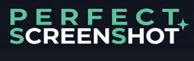

# PerfectScreenShot

[English](README.md) | 한국어

영역을 캡처하고 필요한 표시를 더한 뒤 복사하거나 저장하는 무료 Windows 스크린샷 프로그램입니다.

**[Windows x64용 v2.2.0 캡처 회전 개선본 다운로드](https://github.com/lbs-twtt/PerfectScreenShot-Releases/releases/download/v2.2.0-capture-rotation-20261103/PerfectScreenShot-v2.2.0-capture-rotation-Windows-x64.zip)** · [릴리스 노트](RELEASE_NOTES.md) · [문제 제보](https://github.com/lbs-twtt/PerfectScreenShot-Releases/issues)

v2.2.0은 **시험판**입니다. 스크롤 캡처는 시험 기능이며, Chrome/NAVER에서 자동 수집부터 저장까지 전체 동작은 아직 확인하지 못했습니다. 스크롤 캡처 결과는 미리보기에서 확인한 뒤 사용해 주세요.

## v2.2.0의 새 기능

앱 버전은 **2.2.0**을 유지하고, 같은 버전의 후속 개선으로 캡처 전체 회전을 추가합니다. [이전 괄호 회전·반전 개선본](https://github.com/lbs-twtt/PerfectScreenShot-Releases/releases/tag/v2.2.0-brace-controls-20261103)과 [최초 v2.2.0 배포본](https://github.com/lbs-twtt/PerfectScreenShot-Releases/releases/tag/v2.2.0)도 보존합니다.

- **Ctrl+Shift+R:** 편집 중 누를 때마다 선택한 캡처 전체와 주석을 함께 시계방향으로 90° 회전합니다. 괄호 회전 버튼과는 별도 기능입니다. 현재 편집 중 추가한 표시는 회전 후에도 선택·수정할 수 있고, 회전은 실행 취소·다시 실행할 수 있습니다.
- 회전한 캡처가 화면보다 크면 편집 미리보기만 화면에 맞춰 축소하며 출력은 원본 해상도를 유지합니다. 최근 캡처 편집에서는 원본 크기로 표시하고 스크롤로 이동합니다.
- 텍스트를 입력하는 동안에는 임시로 원래 방향을 보여주고, 입력 완료·취소 후 회전한 방향으로 돌아갑니다. Ctrl+Shift+R은 입력 중인 텍스트를 확정한 뒤 회전합니다. 영역 선택이나 드래그 중에는 회전하지 않습니다.
- **영역 괄호(G):** 드래그해 여러 요소를 묶는 중괄호를 만들고 색상·굵기를 고릅니다. **90° 회전**으로 아래 → 왼쪽 → 위 → 오른쪽 → 아래 순서로 시계방향 회전하며 버튼에 현재 방향도 표시합니다.
- **좌우 반전**은 세로 괄호의 왼쪽·오른쪽을 바꿉니다. 가로 괄호는 좌우 대칭이므로 모양이 그대로임을 안내합니다. 선택(V)한 기존 괄호는 중심 유지로 회전·반전하고 이동·크기 조절·실행 취소·다시 실행할 수 있습니다. 마지막 방향을 다음 괄호에 기억하며 G/Shift+G 굵기 ±1도 유지합니다.
- **번호 크기 수정:** 글꼴 옆 크기 값을 바꾸면 숫자와 원형 배지가 함께 확대·축소됩니다. 선택한 번호는 중심을 유지하고, 선택하지 않은 상태의 변경은 다음 번호에 적용됩니다.
- **N/Shift+N**으로 번호 크기를 1씩 조절하고 글꼴·굵게를 적용합니다. 번호에서는 선 굵기 입력을 비활성화했습니다. 변경은 실행 취소·다시 실행할 수 있습니다.
- 최근 캡처·한국어/영어·출력 기능을 유지합니다. 과거 이미지에 합쳐진 표시는 개별 객체로 복원하지 않습니다.

## v2.1.0의 새 기능

- **Ctrl+Alt+V**로 최근 캡처를 열고 이미지를 선택하면 크게 미리 볼 수 있습니다. **화면에 맞춤**, **100%**, **Ctrl+마우스 휠**로 확대·축소할 수 있습니다.
- **선택 삭제**는 한 장을 삭제하고, **전체 삭제**는 확인 후 목록을 비웁니다. 저장한 파일과 클립보드 내용에는 영향을 주지 않습니다.
- **편집**에서 기존 편집 도구를 사용할 수 있습니다. **편집 완료**를 누르면 파일 저장이나 클립보드 복사 없이 편집본을 최근 캡처에 추가합니다. 복사·저장·고정한 결과도 보관됩니다.
- 원본도 남지만 최대 10장 보관 규칙은 적용됩니다. 같은 편집창에서 다시 출력하면 해당 편집본을 갱신합니다. 이전 표시는 이미지에 합쳐져 있으며 새 표시를 추가하거나 영역을 자를 수 있습니다.
- **Ctrl+Enter**로 편집을 완료합니다. 텍스트 입력 중에는 먼저 글자 입력을 마칩니다. **Esc**나 편집창 닫기는 마지막 출력 이후의 변경을 취소합니다.

## 시작하기

1. 위의 실행용 ZIP을 내려받습니다. Windows 10/11 **64비트(x64)**를 지원합니다.
2. ZIP 전체를 한 폴더에 풀고 포함된 `licenses` 폴더도 함께 둡니다. 다른 버전이 실행 중이면 먼저 종료합니다.
3. `PerfectScreenShot.exe`를 실행합니다. .NET을 별도로 설치할 필요는 없습니다.
4. **Ctrl+Alt+S**를 누르고 영역을 선택한 뒤 필요한 표시를 추가합니다. **Enter**로 복사하고 완료한 후 원하는 곳에 **Ctrl+V**로 붙여넣습니다. PNG/JPG 파일로 저장하려면 **Ctrl+S**를 누릅니다.

GitHub가 자동으로 제공하는 **Source code (zip/tar.gz)**에는 이 저장소의 안내 문서가 들어 있으며 실행 프로그램은 없습니다. 위에 이름이 명시된 실행용 ZIP을 선택하세요.

시작 화면을 닫아도 Windows 알림 영역에서 계속 실행됩니다. 완전히 끝내려면 **프로그램 종료**를 사용하세요. Windows 시작 시 자동 실행은 선택 사항이며 기본으로 꺼져 있습니다.

## 주요 기능

- 직사각형·창·전체화면·자유형 영역 선택과 다중 모니터 지원
- 화살표·상자·타원·직선·펜·형광펜·텍스트·모자이크·가리기·번호 표시
- 크기를 조절할 수 있는 텍스트 상자와 배경색·굵게·기울임·밑줄
- 옮길 수 있는 편집 메뉴, 정밀 확대창과 크기를 바꾸는 십자선
- 클립보드 복사, PNG/JPG 저장, 다른 창 위에 캡처 화면 고정
- 켜고 끌 수 있는 최근 캡처 10장 보관과 미리보기 선택
- 한국어·영어 화면, 내장 도움말과 오프라인 오픈소스 고지

기본으로 **왼쪽 버튼으로 영역을 선택하면 편집 화면**, **오른쪽 버튼으로 선택하면 편집 없이 바로 복사**합니다. 영역 선택 메뉴의 **좌·우 역할 바꾸기** 버튼으로 역할을 뒤집을 수 있습니다. 바로 복사는 클립보드 복사이며 파일 저장은 아닙니다.

## 자주 쓰는 단축키

아래는 기본값입니다. 주요 캡처·도구 단축키는 설정에서 바꿀 수 있습니다.

| 기능 | 단축키 |
|---|---|
| 캡처 시작 | Ctrl+Alt+S |
| 최근 캡처 | Ctrl+Alt+V |
| 직사각형 / 창 / 전체화면 / 자유형 | 영역 선택 중 1 / 2 / 3 / 4 |
| 선택 / 화살표 / 상자 / 텍스트 | V / A / R / T |
| 영역 괄호 / 번호 | G / N |
| 선 굵기 또는 텍스트·번호 크기 증가 / 감소 | 같은 도구 키 반복 / Shift+도구 키 |
| 텍스트 굵게 / 기울임 / 밑줄 | 텍스트 모드에서 Ctrl+B / Ctrl+I / Ctrl+U |
| 복사 후 완료 / 복사 후 계속 편집 | Enter / Ctrl+C |
| 파일 저장 / 화면에 고정 | Ctrl+S / F2 |
| 편집 중 캡처 전체 시계방향 90° 회전 | Ctrl+Shift+R |
| 실행 취소 / 다시 실행 | Ctrl+Z / Ctrl+Y |
| 십자선 크기 / 정밀창 확대 배율 | 영역 선택 중 F1 / Ctrl+휠 |
| 진행 중 조작 취소 또는 대기 중 캡처 닫기 | Esc |

텍스트 입력 중에는 **Enter가 줄바꿈**, **Ctrl+Enter가 입력 완료**입니다. 글자를 입력할 때 문자 단축키는 동작하지 않습니다.

## 언어 설정

설정에서 **자동 / 한국어 / English**를 선택합니다. 자동은 Windows 표시 언어가 한국어이면 한국어, 그 외에는 영어를 사용합니다. **설정을 저장한 뒤 프로그램을 완전히 종료하고 다시 실행**하면 바뀝니다. 번역은 인터넷 없이 동작하며 입력한 주석과 파일명은 번역하지 않습니다.

## 스크롤 캡처 · 시험 기능

**스크롤 캡처**에서 화면에 보이는 창을 선택하고 보관할 화면 수를 정합니다(기본 5장, 범위 1~20장). 프로그램이 아래로 스크롤하며 최대 1장을 더 촬영한 뒤 추가한 마지막 장을 제외합니다. 미리보기에서 상한선·하한선을 정하고 그 사이를 복사하거나 저장합니다. **Esc**로 수집을 중지할 수 있습니다.

자동 연결 과정에서 내용이 어긋나거나 중복될 수 있으며 고정 배너·팝업·움직이는 내용이 있으면 영향을 받습니다. 추가한 마지막 장을 제외해도 앞쪽의 겹침까지 수정되지는 않습니다. 전체 미리보기를 확인해 주세요. Chrome/NAVER의 전체 동작은 아직 미검증입니다.

## 무료 사용과 개인정보

PerfectScreenShot은 무료로 사용할 수 있습니다. 기본 캡처·편집·저장은 계정이나 인터넷 연결 없이 사용자 PC에서 이루어집니다. 프로그램은 캡처 이미지나 개인정보를 별도로 수집하거나 외부 서버로 자동 전송하지 않습니다.

최근 캡처 보관은 시작 화면 또는 설정에서 켜고 끌 수 있습니다. 켜면 최대 10장을 드라이브의 기록 파일이 아닌 **사용자 PC의 메모리에 임시 보관**합니다. 큰 이미지일수록 메모리를 더 사용합니다. 보관을 끄거나 프로그램을 종료·재시작하면 목록이 사라집니다. 사용자가 저장한 파일과 Windows 클립보드에 복사한 내용은 별도로 유지될 수 있습니다.

포함된 구성 요소의 라이선스는 **설정 → 프로그램 정보 → 오픈소스 정보** 또는 함께 제공하는 `licenses` 폴더에서 확인합니다. [외부 구성 요소 고지](licenses/README.md)는 해당 구성 요소에 적용되며 PerfectScreenShot 자체에 오픈소스 라이선스를 부여하는 것은 아닙니다.

## 의견과 문제 제보

[Issues](https://github.com/lbs-twtt/PerfectScreenShot-Releases/issues)에 프로그램 버전, Windows 버전·화면 배율과 문제를 재현하는 순서를 남겨 주세요. 공개 게시판이므로 첨부할 스크린샷에 개인정보나 민감한 내용이 없는지 확인해 주세요.
